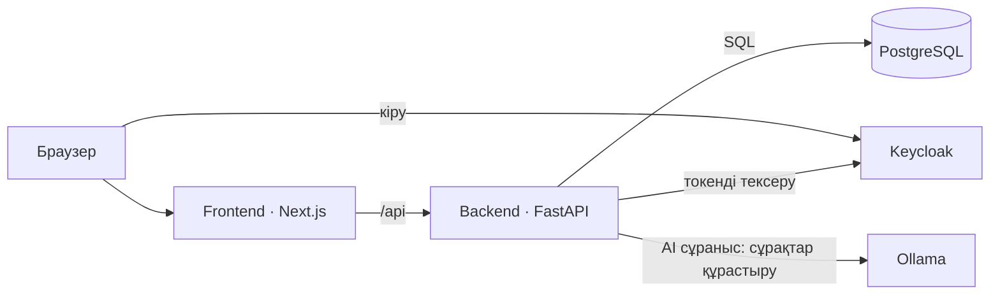

# Архитектура (6-сабақ)
AI Study Assistant — оқытушыларға тест құруға, ал студенттерге пәндер бойынша тест тапсырып, білімін тексеруге арналған веб-қосымша.

## Компоненттер

| Компонент | Не істейді | Сабақ |
|---|---|---|
| **Frontend (Next.js)** | Оқытушы мен студентке арналған веб-интерфейс: тест құру, сұрақтарды басқару, квиз тапсыру және нәтижелерді көру | 10-12 |
| **Backend (FastAPI)** | REST API өңдеу, бизнес-логика (тесттер мен сұрақтарды валидациялау, жауаптарды тексеру, балл есептеу) | 7-9 |
| **Деректер базасы (PostgreSQL)** | Жүйенің барлық негізгі деректерін (`users`, `subjects`, `quizzes`, `questions`, `attempts`) сенімді сақтау | 6 |
| **Аутентификация (Keycloak)** | Пайдаланушыларды жүйеге кіргізу (SSO), студент пен оқытушы рөлдерін басқару және JWT токендерін беру | 8-9 |
| **Жергілікті AI (Ollama)** | Оқытушыға тест тақырыбы бойынша сұрақтар мен нұсқаларды автоматты түрде құрастыруға көмектесу | 13-14 |

> **Тексеру (Чек-лист):**
> - [x] Сызба мен кесте бір-біріне толық сәйкес келеді (барлық 5 компонент қамтылған).
> - [x] П3 ұсынған артық бөліктер қосылмаған (Redis, RabbitMQ, Celery, MinIO алынып тасталды — тек MVP).
> - [x] Жобаның бір сөйлемдік анықтамасы мен AI жебесінің сипаттамасы жазылған.

