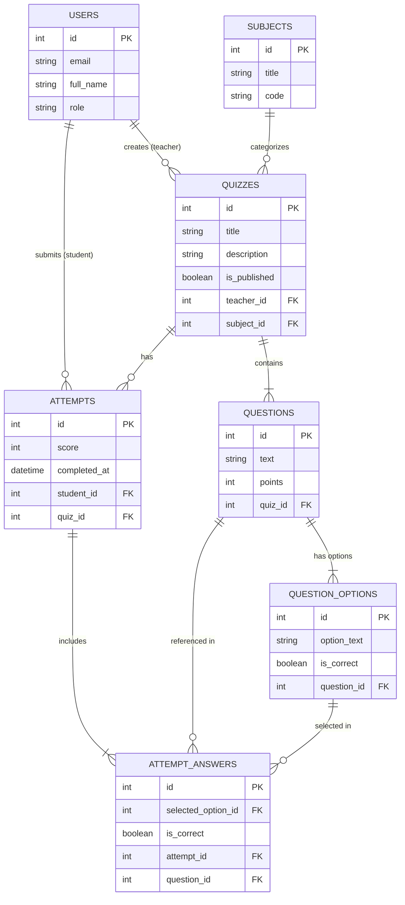

# Деректер моделі (6-сабақ) / Модель данных

## Кестелер (AI-сыз, өзіңіз)

- **users**: `id`, `email`, `full_name`, `role`
- **subjects**: `id`, `title`, `code`
- **quizzes**: `id`, `title`, `description`, `is_published`, `teacher_id`, `subject_id`
- **questions**: `id`, `text`, `points`, `quiz_id`
- **question_options**: `id`, `option_text`, `is_correct`, `question_id`
- **attempts**: `id`, `score`, `completed_at`, `student_id`, `quiz_id`
- **attempt_answers**: `id`, `selected_option_id`, `is_correct`, `attempt_id`, `question_id`

> **Тексеру (Чек-лист):**
> - [x] Әр Must story-дің кестесі бар (пәндерді таңдау, тест құру, нұсқалы сұрақтар қосу, тест тапсыру, нәтиже бағалау).
> - [x] Әр кестеде `id` бар және бағандар саны 3–5 аралығында.
> - [x] Барлық сыртқы кілттер көрсетілген (`teacher_id`, `subject_id`, `quiz_id`, `question_id`, `student_id`, `attempt_id`, `selected_option_id`).
> - [x] `users` кестесінде құпиясөз жоқ (курс талабына сәйкес).

---

## Байланыстар (Связность и внешние ключи)

1. **Студент и попытки сдачи:**
   - *Словесно:* Один студент может проходить много тестов, каждая попытка принадлежит одному студенту.
   - *Кардинальность:* `1 : N`
   - *Внешний ключ:* `attempts.student_id → users.id`

2. **Преподаватель и тесты:**
   - *Словесно:* Один преподаватель может создавать много тестов, каждый тест привязан к создавшему его преподавателю.
   - *Кардинальность:* `1 : N`
   - *Внешний ключ:* `quizzes.teacher_id → users.id`

3. **Предмет и тесты:**
   - *Словесно:* Один учебный предмет может содержать множество тестов, каждый тест относится строго к одному предмету.
   - *Кардинальность:* `1 : N`
   - *Внешний ключ:* `quizzes.subject_id → subjects.id`

4. **Тест и вопросы:**
   - *Словесно:* Один тест содержит много вопросов, каждый вопрос относится к конкретному тесту.
   - *Кардинальность:* `1 : N`
   - *Внешний ключ:* `questions.quiz_id → quizzes.id`

5. **Вопрос и варианты ответов:**
   - *Словесно:* Один вопрос содержит несколько вариантов ответов (A, B, C, D), каждый вариант принадлежит одному вопросу.
   - *Кардинальность:* `1 : N`
   - *Внешний ключ:* `question_options.question_id → questions.id`

6. **Тест и попытки:**
   - *Словесно:* Один тест может иметь множество попыток прохождения разными студентами, каждая попытка относится к конкретному тесту.
   - *Кардинальность:* `1 : N`
   - *Внешний ключ:* `attempts.quiz_id → quizzes.id`

7. **Попытка и ответы студента:**
   - *Словесно:* В рамках одной попытки студент даёт множество ответов, каждый зафиксированный ответ принадлежит одной попытке.
   - *Кардинальность:* `1 : N`
   - *Внешний ключ:* `attempt_answers.attempt_id → attempts.id`

8. **Вопрос и ответы студента:**
   - *Словесно:* На один вопрос в разных попытках даётся множество ответов, каждый ответ ссылается на свой вопрос.
   - *Кардинальность:* `1 : N`
   - *Внешний ключ:* `attempt_answers.question_id → questions.id`

9. **Выбранный вариант ответа:**
   - *Словесно:* Вариант ответа может быть выбран во множестве ответов студентов.
   - *Кардинальность:* `1 : N`
   - *Внешний ключ:* `attempt_answers.selected_option_id → question_options.id`

---

## ER диаграммасы

